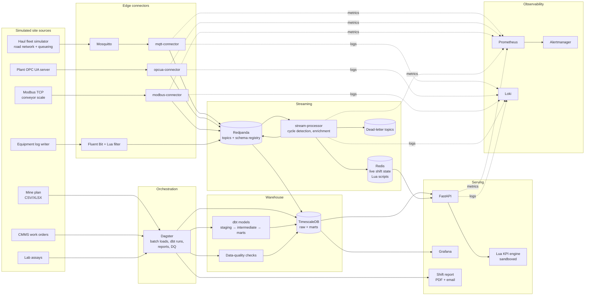

# Mine Site Plan vs. Actual Data Hub

An on-prem, event-driven data platform for an open-pit gold mine. It brings together the mine plan, haul fleet telemetry, processing plant tags and maintenance records, reconciles plan against actual for every shift, and serves the results through an API, dashboards, automated reports and a sandboxed Lua engine where site engineers can write their own KPI calculations.

It's built to look like what a site data engineer actually runs: several industrial protocols, messy vendor data, a streaming backbone, a modeled warehouse, data-quality gates, monitoring of the platform itself, and a repeatable deployment to a site server.

> Status: in progress. See the [Roadmap](#roadmap).

---

## Table of contents

1. [The problem](#the-problem)
2. [What the platform does](#what-the-platform-does)
3. [Architecture](#architecture)
4. [Tech stack](#tech-stack)
5. [Full project structure](#full-project-structure)
6. [Component deep dives](#component-deep-dives)
7. [Data model](#data-model)
8. [Key metrics](#key-metrics)
9. [Data quality](#data-quality)
10. [Lua in this project](#lua-in-this-project)
11. [API](#api)
12. [Monitoring and alerting](#monitoring-and-alerting)
13. [Getting started](#getting-started)
14. [Testing strategy](#testing-strategy)
15. [Deployment to a site server](#deployment-to-a-site-server)
16. [Roadmap](#roadmap)
17. [Results](#results)

---

## The problem

On a typical mine site the data is split across systems that don't talk to each other:

| Data | Usually lives in | Format / protocol |
|---|---|---|
| Mine plan (tonnes, grade, equipment hours) | Planning software | CSV / Excel export |
| Haul truck cycles, payloads, positions | Fleet management system | MQTT / vendor API |
| Crusher and mill throughput, power | PLC / historian | OPC UA, Modbus TCP |
| Equipment status and faults | Onboard controllers | Text log files |
| Work orders, downtime | CMMS | CSV / database |
| Grade control, assays | Lab system | CSV |

Answering *"Did we hit plan last shift, and if not, why?"* means a person stitching these together by hand. This platform does it automatically, every shift, with traceable numbers.

---

## What the platform does

- **Ingests** six source types over MQTT, OPC UA, Modbus TCP, log tailing and batch files.
- **Streams** all real-time data through Redpanda (Kafka API) with schema-validated topics.
- **Tracks live shift state** (tonnes moved, loads per truck, queue lengths) in Redis using atomic Lua scripts.
- **Lands** raw data in TimescaleDB, then models it with dbt into staging, intermediate and mart layers.
- **Reconciles** plan vs. actual per shift, by pit, bench, material and equipment.
- **Detects** truck cycle phases (load, haul, dump, return) from raw GPS and payload signals.
- **Gates** every run with data-quality checks and quarantines bad records instead of dropping them.
- **Lets engineers write their own KPIs** in Lua, run in a sandbox, versioned and tested.
- **Serves** results through a FastAPI service, Grafana dashboards and a scheduled PDF/email shift report.
- **Monitors itself** with Prometheus, Alertmanager and Loki.
- **Deploys** to a single on-prem Linux host with Ansible and Docker Compose.

---

## Architecture



---

## Tech stack

| Layer | Tools |
|---|---|
| Languages | Python 3.11, SQL, Lua 5.4 |
| Industrial protocols | MQTT (Mosquitto, `paho-mqtt`), OPC UA (`asyncua`), Modbus TCP (`pymodbus`) |
| Log processing | Fluent Bit with Lua filters |
| Streaming | Redpanda (Kafka API), Redpanda Schema Registry, `confluent-kafka` |
| Live state | Redis 7 with server-side Lua scripts |
| Storage | PostgreSQL 16 + TimescaleDB (hypertables, continuous aggregates, compression) |
| Transformation | dbt-core + dbt-postgres |
| Orchestration | Dagster |
| Data quality | dbt tests, custom SQL checks, Pydantic contracts at ingest |
| API | FastAPI, SQLAlchemy 2.0, Pydantic v2 |
| User-defined KPIs | Lua sandbox via `lupa` |
| Visualization | Grafana (provisioned dashboards as code) |
| Reporting | `pandas`, `jinja2`, `weasyprint`, SMTP |
| Observability | Prometheus, Alertmanager, Loki, Promtail, `prometheus_client` |
| Migrations | Alembic |
| Testing | `pytest`, `testcontainers`, `hypothesis`, `busted` (Lua tests), `locust` |
| CI | GitHub Actions |
| Deployment | Docker Compose, Ansible, Makefile |

---

## Full project structure

```
mine-site-data-hub/
├── README.md
├── LICENSE
├── Makefile                              # make up / down / test / seed / lint / deploy
├── pyproject.toml                        # workspace config, ruff, mypy, pytest settings
├── .env.example                          # all env vars with safe defaults
├── .pre-commit-config.yaml               # ruff, mypy, sqlfluff, stylua, yamllint
├── docker-compose.yml                    # full stack
├── docker-compose.override.dev.yml       # hot reload, exposed debug ports
├── docker-compose.test.yml               # stack for integration tests
│
├── .github/
│   └── workflows/
│       ├── ci.yml                        # lint, unit tests, Lua tests, dbt compile
│       ├── integration.yml               # testcontainers integration suite
│       └── release.yml                   # build + tag images
│
├── config/
│   ├── site.yaml                         # site name, timezone, shift pattern (2x12h)
│   ├── equipment.yaml                    # fleet list: trucks, shovels, crusher, capacities
│   ├── road_network.yaml                 # haul road graph: nodes, segments, speed limits
│   ├── tags.yaml                         # OPC UA node ids + Modbus registers -> canonical tags
│   ├── status_codes.yaml                 # vendor status code -> RUNNING/STANDBY/DOWN/DELAY
│   └── kpis/                             # user-defined KPI definitions (Lua + metadata)
│       ├── fuel_burn_per_tonne.yaml
│       ├── shovel_hang_time.yaml
│       └── strip_ratio.yaml
│
├── libs/
│   └── minehub_common/                   # shared Python package used by every service
│       ├── pyproject.toml
│       └── minehub_common/
│           ├── __init__.py
│           ├── settings.py               # pydantic-settings, reads env + config/*.yaml
│           ├── logging.py                # structured JSON logging
│           ├── metrics.py                # shared Prometheus counters/histograms
│           ├── shifts.py                 # shift calendar: timestamp -> shift_id, crew
│           ├── units.py                  # tonnes, t/h, km/h conversions
│           ├── kafka/
│           │   ├── producer.py           # idempotent producer, retries, DLQ routing
│           │   ├── consumer.py           # at-least-once consumer, manual commits
│           │   └── serde.py              # Avro (de)serialization via schema registry
│           ├── contracts/                # Pydantic models = data contracts
│           │   ├── truck_telemetry.py
│           │   ├── plant_tag.py
│           │   ├── equipment_event.py
│           │   ├── truck_cycle.py
│           │   ├── plan_row.py
│           │   ├── work_order.py
│           │   └── assay.py
│           └── db/
│               ├── engine.py             # SQLAlchemy engine/session
│               └── bulk.py               # COPY-based bulk insert helpers
│
├── schemas/                              # Avro schemas registered in Redpanda
│   ├── truck_telemetry.v1.avsc
│   ├── plant_tag.v1.avsc
│   ├── equipment_event.v1.avsc
│   ├── truck_cycle.v1.avsc
│   └── register_schemas.py
│
├── simulators/
│   ├── Dockerfile
│   ├── fleet/
│   │   ├── main.py                       # runs the haul fleet simulation
│   │   ├── road_graph.py                 # networkx graph from road_network.yaml
│   │   ├── truck.py                      # truck state machine: queue, spot, load, haul, dump, return
│   │   ├── shovel.py                     # loading unit with service-time distribution
│   │   ├── crusher.py                    # dump point with queue + capacity
│   │   ├── dispatcher.py                 # simple dispatch rules (shortest queue)
│   │   ├── faults.py                     # random breakdowns, GPS dropouts, bad payloads
│   │   └── publisher.py                  # MQTT publish (vendor-style payloads)
│   ├── plant/
│   │   ├── opcua_server.py               # crusher/mill/conveyor tags with drift + noise
│   │   └── modbus_server.py              # belt scale totalizer on holding registers
│   ├── logs/
│   │   └── log_writer.py                 # 3 vendor log formats, intentionally messy
│   └── batch/
│       ├── generate_plan.py              # monthly plan -> shift-level plan XLSX
│       ├── generate_work_orders.py       # CMMS export CSV, linked to simulated faults
│       └── generate_assays.py            # grade control assays per bench/block
│
├── connectors/
│   ├── Dockerfile
│   ├── mqtt_connector/
│   │   ├── main.py                       # subscribe -> validate -> Avro -> Redpanda
│   │   └── vendor_mapping.py             # vendor JSON -> TruckTelemetry contract
│   ├── opcua_connector/
│   │   ├── main.py                       # subscriptions with reconnect + backoff
│   │   ├── browser.py                    # browse address space, verify tags.yaml
│   │   └── quality.py                    # OPC UA status codes -> good/uncertain/bad
│   ├── modbus_connector/
│   │   ├── main.py                       # poll registers on interval
│   │   └── decoding.py                   # 32-bit float/word order, totalizer rollover
│   └── tests/
│
├── fluent-bit/
│   ├── fluent-bit.conf                   # tail inputs, Lua filter, Kafka output
│   ├── parsers.conf                      # regex parsers per vendor format
│   ├── lua/
│   │   ├── normalize_equipment_log.lua   # timestamps -> UTC, status code mapping
│   │   ├── status_map.lua                # generated from config/status_codes.yaml
│   │   └── drop_and_count.lua            # tags malformed lines for the DLQ
│   └── tests/
│       └── normalize_spec.lua            # busted tests
│
├── stream_processor/
│   ├── Dockerfile
│   ├── main.py                           # consumer group entrypoint
│   ├── cycle_detector.py                 # telemetry -> load/haul/dump/return phases
│   ├── geofences.py                      # point-in-polygon for shovels, dumps, crusher
│   ├── enrichment.py                     # attach shift_id, material, location
│   ├── late_data.py                      # watermarking, out-of-order handling
│   ├── live_state.py                     # calls Redis Lua scripts
│   ├── redis_lua/
│   │   ├── record_load.lua               # atomic: shift tonnes, truck loads, last payload
│   │   ├── update_queue.lua              # atomic queue length at each loading/dump point
│   │   └── close_shift.lua               # snapshot + reset counters at shift change
│   └── tests/
│       ├── test_cycle_detector.py        # incl. hypothesis property tests
│       └── test_late_data.py
│
├── sink/
│   ├── Dockerfile
│   └── timescale_sink.py                 # Redpanda -> TimescaleDB, batched COPY, exactly-once via offsets table
│
├── warehouse/
│   ├── alembic.ini
│   ├── migrations/
│   │   └── versions/
│   │       ├── 0001_raw_schema.py        # raw.* tables + hypertables
│   │       ├── 0002_ops_schema.py        # ops.ingest_offsets, ops.quarantine, ops.dq_results
│   │       ├── 0003_compression.py       # compression + retention policies
│   │       └── 0004_continuous_aggs.py   # 1-min / 1-hour plant tag rollups
│   └── dbt/
│       ├── dbt_project.yml
│       ├── profiles.yml
│       ├── packages.yml
│       ├── macros/
│       │   ├── shift_id.sql
│       │   ├── safe_divide.sql
│       │   └── test_freshness_by_tag.sql
│       ├── seeds/
│       │   ├── equipment.csv
│       │   ├── locations.csv
│       │   └── delay_reasons.csv
│       ├── models/
│       │   ├── staging/
│       │   │   ├── stg_truck_cycles.sql
│       │   │   ├── stg_plant_tags.sql
│       │   │   ├── stg_equipment_events.sql
│       │   │   ├── stg_plan.sql
│       │   │   ├── stg_work_orders.sql
│       │   │   ├── stg_assays.sql
│       │   │   └── _staging.yml          # sources, freshness, column tests
│       │   ├── intermediate/
│       │   │   ├── int_equipment_status_intervals.sql   # events -> continuous status intervals
│       │   │   ├── int_time_usage_model.sql             # calendar/available/operating/delay hours
│       │   │   ├── int_cycles_with_grade.sql            # join cycles to assay blocks
│       │   │   └── int_plant_throughput_by_shift.sql
│       │   └── marts/
│       │       ├── dim_shift.sql
│       │       ├── dim_equipment.sql
│       │       ├── dim_location.sql
│       │       ├── dim_material.sql
│       │       ├── fct_truck_cycle.sql
│       │       ├── fct_equipment_shift.sql              # availability, utilization per unit/shift
│       │       ├── fct_plan_vs_actual.sql               # the core reconciliation
│       │       ├── fct_maintenance.sql                  # MTBF, MTTR, planned vs unplanned
│       │       ├── fct_grade_reconciliation.sql         # planned vs mined vs milled grade
│       │       └── _marts.yml
│       └── tests/
│           ├── assert_tonnes_balance.sql                # mined tonnes ≈ dumped tonnes
│           ├── assert_time_usage_sums_to_calendar.sql
│           └── assert_no_overlapping_status_intervals.sql
│
├── orchestration/
│   ├── Dockerfile
│   ├── workspace.yaml
│   └── minehub_dagster/
│       ├── __init__.py
│       ├── definitions.py
│       ├── resources.py                  # db, redis, smtp, dbt resources
│       ├── assets/
│       │   ├── batch_plan.py             # load + validate shift plan XLSX
│       │   ├── batch_work_orders.py
│       │   ├── batch_assays.py
│       │   ├── dbt_assets.py             # dbt models as Dagster assets
│       │   ├── data_quality.py           # run checks, write ops.dq_results
│       │   └── shift_report.py
│       ├── sensors/
│       │   ├── new_plan_file.py          # triggers on a new file in the drop folder
│       │   └── shift_change.py           # triggers end-of-shift pipeline
│       └── schedules.py
│
├── kpi_engine/
│   ├── Dockerfile
│   ├── engine.py                         # loads config/kpis/*.yaml, runs Lua in lupa sandbox
│   ├── sandbox.py                        # whitelisted globals, CPU/memory/instruction limits
│   ├── data_bindings.py                  # exposes read-only shift data to Lua
│   ├── registry.py                       # KPI versions, owners, last run, errors
│   └── tests/
│       ├── test_sandbox_escape.py        # os/io/require must be unreachable
│       └── test_kpis.py
│
├── api/
│   ├── Dockerfile
│   └── app/
│       ├── main.py
│       ├── deps.py                       # db session, redis, auth
│       ├── auth.py                       # API-key auth with roles (viewer, engineer, admin)
│       ├── routers/
│       │   ├── health.py
│       │   ├── shifts.py                 # GET /shifts, /shifts/{id}/plan-vs-actual
│       │   ├── live.py                   # GET /live/shift (from Redis), SSE stream
│       │   ├── equipment.py              # GET /equipment/{id}/kpis
│       │   ├── maintenance.py
│       │   ├── kpis.py                   # list/run/validate Lua KPIs
│       │   └── data_quality.py           # GET /dq/results, /dq/quarantine
│       ├── schemas/                      # response models
│       └── services/
│           ├── reconciliation.py
│           └── live_state.py
│
├── reporting/
│   ├── Dockerfile
│   ├── shift_report.py                   # build report for a shift
│   ├── charts.py                         # matplotlib charts embedded in the PDF
│   ├── commentary.py                     # rule-based "why we missed plan" notes
│   ├── mailer.py
│   └── templates/
│       ├── shift_report.html
│       └── styles.css
│
├── observability/
│   ├── prometheus/
│   │   ├── prometheus.yml
│   │   └── rules/
│   │       ├── platform.rules.yml        # service down, ingest lag, disk, memory
│   │       └── data.rules.yml            # stale tags, DLQ growth, DQ failures
│   ├── alertmanager/
│   │   └── alertmanager.yml              # email routing, grouping, silences
│   ├── loki/
│   │   └── loki-config.yml
│   └── promtail/
│       └── promtail-config.yml
│
├── grafana/
│   ├── provisioning/
│   │   ├── datasources/datasources.yml   # TimescaleDB, Prometheus, Loki
│   │   └── dashboards/dashboards.yml
│   └── dashboards/
│       ├── shift_overview.json
│       ├── haul_fleet.json
│       ├── plant.json
│       ├── maintenance.json
│       ├── grade_reconciliation.json
│       ├── data_quality.json
│       └── platform_health.json
│
├── deploy/
│   ├── ansible/
│   │   ├── inventory.example.ini
│   │   ├── site.yml                      # full deploy playbook
│   │   └── roles/
│   │       ├── base/                     # users, firewall, time sync, docker
│   │       ├── minehub/                  # copy compose + config, pull images, start
│   │       └── backup/                   # nightly pg_dump + config backup, retention
│   └── scripts/
│       ├── backup.sh
│       ├── restore.sh
│       └── healthcheck.sh
│
├── data/
│   ├── drop/                             # watched folder for plan/CMMS/assay files
│   └── samples/
│       ├── mine_plan_2026-11.xlsx
│       ├── work_orders_sample.csv
│       └── assays_sample.csv
│
├── tests/
│   ├── integration/
│   │   ├── conftest.py                   # testcontainers: redpanda, timescale, redis
│   │   ├── test_mqtt_to_warehouse.py     # end-to-end: simulated load -> fct_truck_cycle
│   │   ├── test_opcua_reconnect.py       # server restart, no data loss
│   │   ├── test_dlq_routing.py
│   │   └── test_shift_close.py
│   ├── load/
│   │   └── locustfile.py                 # API load test
│   └── fixtures/
│
└── docs/
    ├── architecture.md
    ├── data_contracts.md
    ├── kpi_authoring_guide.md            # how site engineers write Lua KPIs
    ├── runbook.md                        # what to do when each alert fires
    ├── adr/                              # architecture decision records
    │   ├── 0001-redpanda-over-kafka.md
    │   ├── 0002-timescaledb-over-influxdb.md
    │   └── 0003-lua-for-user-kpis.md
    └── screenshots/
```

---

## Component deep dives

### 1. Haul fleet simulator
A discrete-event simulation of a real haul cycle, so the downstream logic has realistic data to work with.

- The haul road is a graph (`networkx`) with segment lengths, grades and speed limits.
- Trucks run a state machine: `QUEUE → SPOT → LOAD → HAUL_FULL → QUEUE_DUMP → DUMP → HAUL_EMPTY`.
- Shovels and the crusher have service-time distributions and capacity, so queues form naturally.
- A fault injector adds breakdowns, GPS dropouts, duplicate messages, out-of-order timestamps and impossible payloads.
- Messages go out in a vendor-style JSON format, not the platform's format, so the connector has real mapping work to do.

### 2. Edge connectors
One service per protocol. Each one:
- maps vendor fields to a Pydantic data contract
- sends anything that fails validation to a dead-letter topic with the reason attached
- reconnects with exponential backoff (OPC UA and Modbus servers get restarted in tests)
- exposes Prometheus metrics: messages in/out, validation failures, last message time

The Modbus connector handles 32-bit float word order and totalizer rollover. These are the details that break real integrations.

### 3. Stream processor
- **Cycle detection:** turns raw telemetry into completed truck cycles using geofences plus payload changes (a payload jump inside a shovel geofence = load; a drop inside a dump geofence = dump).
- **Late and out-of-order data:** watermarks per truck; late events update the cycle instead of being dropped.
- **Live state:** each completed load calls `record_load.lua` in Redis, which updates shift tonnes, per-truck load counts and the last payload in one atomic step.

### 4. Warehouse and dbt
- Raw tables are TimescaleDB hypertables with compression after 7 days.
- Continuous aggregates roll plant tags up to 1-minute and 1-hour buckets.
- dbt builds staging → intermediate → marts. The hardest model is `int_equipment_status_intervals`, which turns status events into gap-free, non-overlapping intervals for the time usage model.

### 5. Orchestration
Dagster runs everything that isn't streaming:
- a sensor watches `data/drop/` and loads new plan, CMMS and assay files
- a shift-change sensor runs dbt, data-quality checks and the shift report in order
- every asset has lineage, so a bad plan file shows exactly which marts and reports it touched

### 6. Lua KPI engine
Site engineers often want their own calculations without waiting on a developer. They write a short Lua function plus a YAML file, and the engine:
- runs it in a `lupa` sandbox with no `os`, `io`, `require` or `load`
- enforces instruction count, memory and time limits
- passes in read-only shift data
- stores results with the KPI version, so changing a formula never silently rewrites history

### 7. Shift report
Generated automatically at each shift change:
- plan vs. actual by material and pit
- fleet availability and utilization
- top delays and breakdowns
- rule-based commentary such as *"Crusher was down 47 min (WO-10231); estimated impact −2,100 t"*
- data-quality status, so readers know if any numbers are incomplete

---

## Data model

**Dimensions**
- `dim_shift`: shift id, start, end, day/night, crew
- `dim_equipment`: unit id, class, fleet, model, nominal payload, commissioned date
- `dim_location`: pit, bench, block, dump, stockpile, crusher, with geofence polygon
- `dim_material`: ore/waste, grade band, destination rule

**Facts**
- `fct_truck_cycle`: one row per completed cycle, with phase durations, payload, source, destination, material and grade
- `fct_equipment_shift`: one row per unit per shift, with time usage breakdown
- `fct_plan_vs_actual`: one row per shift × location × material, with planned and actual tonnes, variance and variance %
- `fct_maintenance`: work orders with downtime, planned/unplanned, linked to equipment events
- `fct_grade_reconciliation`: planned vs. mined vs. milled grade per shift

**Ops schema**
- `ops.ingest_offsets`: Kafka offsets committed with the data, for exactly-once sinking
- `ops.quarantine`: rejected records, with reason and source
- `ops.dq_results`: every data-quality check run, pass/fail and row counts
- `ops.kpi_runs`: Lua KPI executions, with version, duration and errors

---

## Key metrics

| Metric | Definition |
|---|---|
| Plan compliance | Actual tonnes ÷ planned tonnes |
| Truck cycle time | Queue + spot + load + haul + dump + return |
| Payload compliance | % of loads within the target band (e.g. 90–110% of nominal) |
| Physical availability | (Calendar − downtime) ÷ calendar hours |
| Utilization | Operating ÷ available hours |
| MTBF | Operating hours ÷ unplanned failures |
| MTTR | Repair hours ÷ number of repairs |
| Crusher throughput | Tonnes per operating hour vs. nameplate |
| Shovel hang time | Time a shovel waits with no truck (Lua KPI) |
| Strip ratio | Waste tonnes ÷ ore tonnes (Lua KPI) |
| Grade variance | Mined grade − planned grade, by block |

---

## Data quality

Checks run at three points.

**At ingest (contracts):** schema, types, ranges, required fields. Failures go to dead-letter topics and `ops.quarantine`.

**In dbt (tests):** uniqueness, not-null, accepted values, relationships, plus custom tests:
- `assert_tonnes_balance`: tonnes loaded ≈ tonnes dumped per shift
- `assert_time_usage_sums_to_calendar`: every unit's hours add up to 12 per shift
- `assert_no_overlapping_status_intervals`

**Scheduled (Dagster):**
- stale tags (no value within N minutes)
- missing shifts (no plan or no actuals)
- dead-letter topic growth rate
- OPC UA bad-quality ratio per tag

All results land in `ops.dq_results` and show on the Data Quality dashboard and in the shift report.

---

## Lua in this project

Lua is used in three places, each with a real reason:

| Where | Why Lua |
|---|---|
| Fluent Bit filters | Fluent Bit's built-in scripting language; lightweight per-record parsing of vendor logs |
| Redis scripts | Atomic multi-key updates for live shift counters without race conditions |
| KPI engine | Small, embeddable, easy to sandbox; lets non-developers write calculations safely |

Example user-defined KPI (`config/kpis/strip_ratio.yaml`):

```yaml
name: strip_ratio
version: 2
owner: mine-engineering
description: Waste tonnes divided by ore tonnes for the shift
inputs: [tonnes_by_material]
lua: |
  local waste = inputs.tonnes_by_material["WASTE"] or 0
  local ore = inputs.tonnes_by_material["ORE"] or 0
  if ore == 0 then return nil end
  return waste / ore
```

---

## API

| Method | Endpoint | Description |
|---|---|---|
| GET | `/health` | Liveness and dependency checks |
| GET | `/shifts` | List shifts with headline compliance |
| GET | `/shifts/{id}/plan-vs-actual` | Reconciliation by location and material |
| GET | `/live/shift` | Current shift counters from Redis |
| GET | `/live/stream` | Server-sent events for live dashboards |
| GET | `/equipment/{id}/kpis` | Availability, utilization, MTBF, MTTR |
| GET | `/maintenance/work-orders` | Filterable work orders |
| GET | `/kpis` | Registered Lua KPIs |
| POST | `/kpis/validate` | Dry-run a Lua KPI against a past shift |
| POST | `/kpis/{name}/run` | Run a KPI for a shift (engineer role) |
| GET | `/dq/results` | Data-quality results |
| GET | `/dq/quarantine` | Quarantined records |

OpenAPI docs: `http://localhost:8000/docs`

---

## Monitoring and alerting

| Alert | Condition |
|---|---|
| `ConnectorDown` | No metrics scraped for 2 min |
| `IngestStalled` | No messages from a source for 5 min |
| `ConsumerLagHigh` | Stream processor lag > 10,000 messages |
| `DLQGrowing` | Dead-letter rate > 1% of input |
| `TagStale` | Critical plant tag has no update for 10 min |
| `DQFailure` | Any critical data-quality check fails |
| `DiskFilling` | Host disk > 80% |
| `BackupMissed` | No successful backup in 26 h |

Each alert has a matching section in `docs/runbook.md`.

---

## Getting started

### Prerequisites
- Docker and Docker Compose
- Make
- Python 3.11+ (for running tests locally)

### Run the full stack

```bash
git clone https://github.com/sajansshergill/mine-site-data-hub.git
cd mine-site-data-hub
cp .env.example .env
make up          # starts all services
make seed        # registers schemas, runs migrations, loads dbt seeds and sample files
```

| Service | URL |
|---|---|
| Grafana | http://localhost:3000 |
| API docs | http://localhost:8000/docs |
| Dagster | http://localhost:3001 |
| Redpanda Console | http://localhost:8080 |
| Prometheus | http://localhost:9090 |
| Alertmanager | http://localhost:9093 |
| OPC UA | opc.tcp://localhost:4840 |
| Modbus TCP | localhost:5020 |
| MQTT | localhost:1883 |

### Common commands

```bash
make logs s=stream_processor   # tail one service
make dbt-run                   # run dbt models
make report shift=latest       # generate a shift report
make chaos                     # restart OPC UA server + inject faults
make down
```

---

## Testing strategy

| Level | What | Tools |
|---|---|---|
| Unit | Mapping, decoding, cycle detection, shift calendar | `pytest`, `hypothesis` |
| Lua | Fluent Bit filters, Redis scripts, KPI sandbox | `busted`, `pytest` + `lupa` |
| dbt | Model tests and custom assertions | `dbt test` |
| Integration | Source → Redpanda → TimescaleDB → marts, end to end | `testcontainers` |
| Resilience | Connector reconnects, late data, duplicate messages | `make chaos`, integration tests |
| Security | Lua sandbox escape attempts | `pytest` |
| Load | API under concurrent dashboard users | `locust` |

```bash
make test             # unit + Lua
make test-integration
make test-all
```

---

## Deployment to a site server

```bash
cp deploy/ansible/inventory.example.ini deploy/ansible/inventory.ini
# edit host, user, paths
make deploy
```

The playbook installs Docker, sets up time sync (shift boundaries depend on correct clocks), firewall rules, the stack, nightly backups with retention, and a systemd unit so the stack comes back after a reboot.

---

## Roadmap

**Phase 1: Foundations**
- [ ] Repo setup, shared library, settings, logging, CI
- [ ] Docker Compose with TimescaleDB, Redpanda, Redis, Mosquitto
- [ ] Alembic migrations for raw and ops schemas

**Phase 2: Sources and ingestion**
- [ ] Fleet simulator with road graph and queueing
- [ ] OPC UA and Modbus plant simulators
- [ ] Log writer with three vendor formats
- [ ] MQTT, OPC UA and Modbus connectors with contracts and DLQ
- [ ] Fluent Bit + Lua log normalization

**Phase 3: Streaming**
- [ ] Avro schemas and registry
- [ ] Cycle detection with geofences
- [ ] Late and out-of-order handling
- [ ] Redis Lua live shift state
- [ ] Exactly-once TimescaleDB sink

**Phase 4: Warehouse**
- [ ] dbt staging, intermediate and marts
- [ ] Time usage model and plan vs. actual
- [ ] Grade reconciliation
- [ ] Custom dbt tests

**Phase 5: Orchestration and quality**
- [ ] Dagster assets, sensors and schedules
- [ ] Scheduled data-quality checks

**Phase 6: Serving**
- [ ] FastAPI with roles
- [ ] Lua KPI engine and sandbox
- [ ] Grafana dashboards as code
- [ ] Automated shift report with commentary

**Phase 7: Operations**
- [ ] Prometheus, Alertmanager, Loki
- [ ] Runbook
- [ ] Ansible deployment and backups
- [ ] Integration, resilience and load tests

**Stretch**
- [ ] Shift tonnes forecast for the rest of the shift
- [ ] Anomaly detection on crusher power
- [ ] Offline buffering at the edge for network outages

---

## Results

_To be filled in after the build._

- Data sources unified:
- Messages processed per simulated shift:
- End-to-end latency (truck dump → live dashboard):
- Time to produce a shift report (manual vs. automated):
- Data-quality issues caught per simulated day:
- Test coverage:

---

## Notes

All site data in this project is simulated. Equipment names, tags, plan figures and assays are made up and don't come from any real operation.

## Author

**Sajan Shergill**
[Portfolio](https://sajansshergill.github.io) · [LinkedIn](https://linkedin.com/in/sajanshergill) · [GitHub](https://github.com/sajansshergill)
